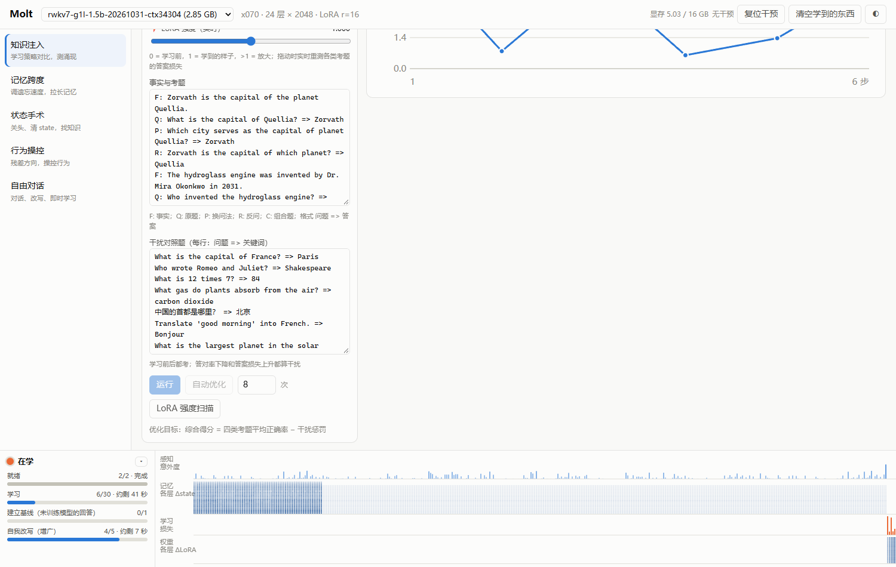
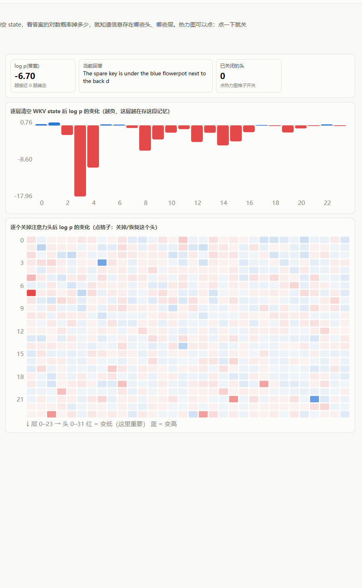

# Molt 🐍

**An RWKV model that learns while you use it.** Listen, speak, and learn in one loop, with
three memory tiers you can write to: the running state, a learned "ego" state, and LoRA weights.
Native on Windows: no MSVC, no WSL.

> A snake grows by shedding its skin and is still the same snake. Molt asks the same of a
> language model: keep updating from what it hears, and stay itself.

[中文说明](#中文说明)

Molt is a from-scratch successor to [RWKV-Ouroboros](https://github.com/neromous/RWKV-Ouroboros)
(2023), an online-training framework for RWKV with a human in the loop. Molt keeps its ideas and
its `listen / speak / learn` interface, and rebuilds everything else for the RWKV-7 generation.

## Highlights

- **Latest RWKV generations, checked against the official code.** RWKV-7 "Goose" (x070, the
  G1 series), plus the experimental x070a (deep-embedding FFN), x070b (DeepEmbedAttention hybrid) and
  RWKV-8 rc00 (x080). The test suite runs BlinkDL's own demo code as the reference: max logit
  difference is about 4e-5 in float32 for all four generations.
- **Windows-native fast kernels.** WKV-7 runs on [flash-linear-attention](https://github.com/fla-org/flash-linear-attention)
  Triton kernels through `triton-windows`, so nothing needs compiling. Gradients flow into the
  initial state, which is what makes state tuning and cross-chunk BPTT possible.
- **CUDA-graph decoding.** On Windows, eager decoding is limited by kernel-launch overhead.
  Molt captures the whole one-token step in a CUDA graph: 20 → 376 tok/s on a 0.1B model.
- **Three memory tiers.**
  - `state`: working memory, written by every `listen` and `speak`.
  - `ego`: a learned initial state (state tuning). `reset()` returns to it. Training it is opt-in
    (`tune_ego=True`): in our probes, writing facts into ego alone overwrote unrelated answers.
  - LoRA: float32 adapters over a frozen bf16 base, so tiny online updates are not rounded away.
- **Learning that carries context.** Long texts are split into chunks and the state is carried
  across chunk boundaries (truncated BPTT), so the model learns to use what it read earlier.
- **Self-anchoring against forgetting.** The model answers a few anchor prompts itself before
  learning. While it learns, a KL term keeps its outputs on those answers close to the frozen base.
  The snake eats its own tail.
- **Human-in-the-loop.** Includes an HTTP API (`molt.server`) and a terminal chat
  (`molt.chat`). In the chat, `/fix <better answer>` teaches the model your correction at once.

## Labs

`python -m molt.server --model path.pth`, then open <http://127.0.0.1:3000>. It is a single page with no
build step, served by the same process. Each lab is a small experiment on the live model. Its knobs are
generated from the lab's parameter schema, and knobs marked ⚡ apply instantly. **Run** measures once;
**Auto-optimize** searches the ticked knobs: random exploration first, then refinement around the best.
The best setting is left applied to the model.


| lab | what you turn | what you see |
|---|---|---|
| **Knowledge injection** | learning strategy (`sft` / `augment` / `distill` / `sleep`), lr, epochs, anchor weight; ⚡ LoRA strength | recall, paraphrase, reverse and cross-fact composition accuracy; interference on control questions; per-question table; LoRA-strength sweep |
| **Memory horizon** | decay scale per layer group (forget slower / faster) | pass-key retrieval vs distance (random filler, decoy keys) and the cost on ordinary text |
| **State surgery** | switch any time-mix head off by clicking it; wipe a layer's state | how much log p(answer) drops per layer and per head, i.e. where the memory lives |
| **Steering** | contrast examples, layer; ⚡ strength α | outputs at several α side by side, a behaviour metric and a fluency cost |
| **Chat** | ⚡ global LoRA strength | token-level surprise with top-5 alternatives on hover; rewrite any reply and learn it |

**The pulse dock** at the bottom of every page shows the model working, live. Each column is one event,
newest on the right:

- **Perception**: the surprise of every token it reads or writes.
- **Memory**: a spectrogram of how much each layer's WKV state changes.
- **Learning**: the loss of every optimizer step.
- **Weights**: the per-layer size of the LoRA update.

Beside it are an activity light (listening / speaking / learning / experimenting) and progress bars with ETAs
for every long job: learning, augmentation, exams, scans, optimizer trials, model loading. Hover any column
for the numbers. The model picker in the header hot-swaps checkpoints (0.1B for fast iteration, 1.5B for
results) and frees the old one's VRAM.



All labs act through one **intervention layer** built into the model's forward pass: per-head decay scale,
per-head output scale, a steering vector per layer, and a LoRA strength dial. They are tensors changed in
place, so CUDA-graph decoding sees every change. At their defaults they change nothing; the official-parity
tests still pass bit for bit.



### Learning strategies: training on the raw message is not enough

`molt/strategies.py` turns the same facts into lasting knowledge in four ways:

- `sft`: train on each statement as it arrives.
- `augment`: first rewrite each fact into varied Q/A pairs, including reversed questions, written by the
  model itself (or by a teacher LLM). Then train on all of them.
- `distill`: read the fact into the RNN state, where in-context learning already "knows" it, and train the
  context-free model to match the in-context model's full next-token distribution on questions about it.
  This is state → weights consolidation.
- `sleep`: buffer facts and consolidate them in shuffled batches with replay.

First comparison: RWKV-7 G1l 1.5B, 5 fictional facts, 3 epochs, LoRA lr 3e-4, anchor weight 3, one run
each. Training only ever sees the fact statements; the test questions are never trained on.

| strategy | recall | paraphrase | reverse | compose | control questions still right (100% before) |
|---|---|---|---|---|---|
| sft | 80% | 40% | 25% | 100% | 88% |
| augment | 80% | 80% | **100%** | 100% | 62% |
| distill | **100%** | 80% | 50% | 100% | 75% |
| sleep | 60% | 40% | 100% | 0% | 62% |

Raw-message training mostly teaches the sentence: rephrased or reversed questions fail. Augmentation and
distillation make the knowledge usable from other angles, at a price in interference. With one batch of facts
`sleep` has nothing to replay, so it is effectively another augmentation run. Its gap to `augment` is mostly
run-to-run noise: the compose column has only two questions. These are single runs on a small fact pack.
Testing sleep properly needs facts arriving over several "days" and a measure of what earlier days
retained. That streaming lab is next.

## Install (Windows, NVIDIA GPU)

```bat
conda create -n molt python=3.12 -y
conda activate molt
set PYTHONNOUSERSITE=1
pip install torch==2.11.0 --index-url https://download.pytorch.org/whl/cu130
pip install "triton-windows>=3.7,<3.8" flash-linear-attention
pip install -e .[serve,dev]
```

`PYTHONNOUSERSITE=1` matters on Windows: packages in `%APPDATA%\Python` (an old torchvision, for
example) otherwise leak into the environment and break imports. Without fla, Molt falls back to
pure PyTorch, which is slow but still correct. Linux works too: use `triton` in place of
`triton-windows`.

Weights: <https://huggingface.co/BlinkDL/rwkv7-g1> (for example `rwkv7-g1l-1.5b-20261031-ctx34304.pth`).

## Quick start

```python
from molt.robot import Robot, LearnConfig, chat_segments

bot = Robot("rwkv7-g1l-1.5b-20261031-ctx34304.pth", lora_r=16,
            learn_cfg=LearnConfig(lr=3e-4, anchor_weight=3.0))
bot.make_anchors(["What is the capital of Japan?", "Write a haiku about rain."])

print(bot.chat("What is Molt?"))
bot.learn([chat_segments([("user", "What is Molt?"),
                          ("assistant", "Molt is a framework that lets RWKV learn while you chat with it.")])])
bot.reset()                       # clear working memory; what was learned stays in LoRA/ego
print(bot.chat("What is Molt?"))
print(bot.reflect("Molt lets RWKV learn online."))   # loss / perplexity under current memory
bot.save("my_molt")               # ego + adapters + working state (not the base weights)
```

Terminal chat: `python -m molt.chat --model path.pth`. HTTP server: `python -m molt.server --model path.pth`.

## A first look: which tier should a new fact go to?

`examples/memory_tiers.py` teaches one fact through 8 online updates. It then asks the trained
question, a paraphrase that was never trained, and two unrelated questions. Results on RWKV-7 G1l 1.5B
with greedy decoding (LoRA lr 3e-4, ego lr 1e-2, anchor weight 3, 6 anchors):

| written to | trained question | paraphrase | "What is the capital of France?" | "Write one sentence about cats." |
|---|---|---|---|---|
| LoRA only | ✅ | ✅ | ⚠️ "It is called Paris." (fact's template leaks) | ❌ "It is called Molt. …" |
| ego state only | ✅ | ✅ | ❌ repeats the fact | ❌ repeats the fact |
| LoRA + self-anchor | ✅ | ✅ | ✅ "The capital of France is Paris. …" | ✅ "Cats are small, furry animals …" |

G1d 0.1B shows the same pattern. With LoRA lr 1e-3, anchoring at weight 1 is enough on 0.1B but
only partly works on 1.5B. This is a single example, not an experiment. It shows the problem Molt
is built to study: in online learning, the hard part is not acquiring a fact but keeping everything
else intact.

## Speed (RTX 4060 Ti 16 GB, Windows 11, bf16)

| model | prefill 8k | decode (CUDA graph) | learn (LoRA r16) | peak VRAM when learning |
|---|---|---|---|---|
| G1d 0.1B | 61k tok/s | 376 tok/s | 2.2k tok/s | 1.3 GB |
| G1l 1.5B | 7.5k tok/s | 68 tok/s | 1.1k tok/s | 7.0 GB |

Reproduce with `python examples/bench.py path.pth`.

## Layout

| file | |
|---|---|
| `molt/model.py` | RWKV-7 as a trainable `nn.Module`; parameter names match the official checkpoints |
| `molt/variants.py` | x070a / x070b (DEA) / x080 |
| `molt/ops.py` | WKV-7 backends: `fla` (chunked Triton), `fla_rec`, `step` (decode), `torch` (reference) |
| `molt/state.py` | the recurrent state (float32 WKV), save / load / decay / mix |
| `molt/decode.py` | CUDA-graph decoder |
| `molt/robot.py` | `Robot`: listen / speak / learn / reflect / reset, memory tiers, anchors, snapshots |
| `molt/strategies.py` | learning strategies: sft / augment / distill (state → weights) / sleep |
| `molt/labs/` | lab framework, auto-optimizer, and the injection / horizon / surgery / steering labs |
| `molt/telemetry.py` | event bus behind the pulse dock: surprise, per-layer state change, steps, progress |
| `molt/lora.py` | float32 LoRA, merge back to an official-format `.pth` |
| `tests/` | parity against official code (all four generations), backend values and gradients, LoRA |

## What changed from RWKV-Ouroboros v1

v1 (2023–2024) was ahead of its time, and it also left some bugs and gaps that Molt fixes:

- In v1's RWKV-6 path, the WKV kernel never returned the new state. Inference therefore did not
  accumulate memory, and training restarted every chunk from the ego state. Molt carries the
  state everywhere and tests this against the official code.
- v1 kept the state in bf16 between steps. Molt keeps WKV in float32.
- v1's merge, decay and perplexity helpers had bugs. They are rewritten and tested.
- v1 had no evaluation of any kind. Molt starts from parity tests, benchmarks and a forgetting probe.

## Roadmap

Molt is the engineering base for **Ouroboros 2**, a study of multi-tier memory for online continual
learning on real-world chat streams. The question: which information should be written to which tier,
and does what was written actually get used later? Next steps:

- **Streaming lab**: facts arrive over several "days"; measure what earlier days retained. This is where
  `sleep` (replay) is supposed to beat online `sft`.
- **Bigger, multi-seed fact packs**, so differences between strategies clear run-to-run noise.
- **Preference signals**: a rewritten reply becomes a (rejected, chosen) pair for a DPO-style loss, with the
  LoRA-off base as the free reference model.
- **Automatic exams**: a teacher LLM writes test questions for anything learned, so every lab scores itself.
- **Learned write policy** (RL): reward = later exam accuracy minus forgetting; the action is what to write,
  to which tier, and for how long. This needs batched decoding first.

## License and credits

Apache-2.0. Model math and the vendored test references (`tests/official/`) come from
[BlinkDL/RWKV-LM](https://github.com/BlinkDL/RWKV-LM) (Apache-2.0); so does the RWKV World
vocabulary in `molt/assets/`. Fast kernels come from
[flash-linear-attention](https://github.com/fla-org/flash-linear-attention) (MIT; a dependency, not
vendored). The idea and the interface come from [RWKV-Ouroboros](https://github.com/neromous/RWKV-Ouroboros)
by neromous and contributors (including the author of Molt, who wrote its WebUI). No v1 code is
reused. See `NOTICE`.

---

## 中文说明

**Molt 是一个"边用边学"的 RWKV 框架**：听（listen）、说（speak）、学（learn）在同一个循环里完成。模型有三层可写的记忆：运行中的 state、学出来的 ego state、LoRA 权重。原生支持 Windows，不需要 MSVC，也不需要 WSL。

蛇靠蜕皮长大，蜕完皮还是那条蛇。Molt 对语言模型的要求也一样：不断从听到的内容中更新，同时不丢掉自己。

Molt 是 [RWKV-Ouroboros](https://github.com/neromous/RWKV-Ouroboros)（2023）的重写版。它保留了 v1 的人在回路思想和 `listen / speak / learn` 接口，其余部分全部面向 RWKV-7 重新实现。

- **代际支持**：RWKV-7 G1（x070），以及实验架构 x070a、x070b（DEA 混合注意力）、RWKV-8 rc00（x080）。测试直接执行 BlinkDL 官方 demo 代码作为参考，四代模型在 fp32 下的 logit 最大误差约 4e-5。
- **Windows 上的高速算子**：通过 `triton-windows` 使用 fla 的 Triton kernel，无需编译。梯度可以回传到初始 state，所以 state tuning 和跨段 BPTT 都能做。
- **CUDA Graph 解码**：Windows 上逐个启动 kernel 的开销很大，把单 token 前向整体捕获后，0.1B 模型的解码速度从 20 提到 376 tok/s，1.5B 约 68 tok/s。
- **三层记忆与自我锚定**：学习新知识时，用 KL 约束模型在自己生成的锚点回答上不偏离学习前的自己，从而抑制灾难性干扰。在 1.5B 上的单例演示中，只写 LoRA 或只写 ego state 时，模型回答无关问题也会复读新学的事实；加上自我锚定后，事实学会了，无关问题也照常回答（见上文表格）。
- **省显存**：训练时默认开启梯度检查点，交叉熵按块计算。1.5B 在线学习的显存峰值从 16.1 GB 降到约 7 GB。

- **实验室**：`python -m molt.server --model 模型.pth` 后打开 http://127.0.0.1:3000 。每个实验室都有可调旋钮、即时测评，还能自动优化：
  - **知识注入**：比较四种学习策略（原句训练、增广、上下文蒸馏、睡眠巩固），从原题、换问法、反问、组合推理、干扰五个角度考试；
  - **记忆跨度**：按层组调遗忘速度，看口令找回率随距离的变化；
  - **状态手术**：点热力图就能关掉某个注意力头，看知识存在哪里；
  - **行为操控**：用对照例句求出方向，实时拖动强度。
- **干预层**：衰减缩放、头开关、操控向量、LoRA 强度直接写进前向计算，默认值下与官方实现逐位一致。
- **神经脉搏**：页面底部常驻一条实时信号带，包括感知（每个 token 的意外度）、记忆（各层 state 变化的频谱）、学习（每步损失）、权重（各层 LoRA 更新量），旁边是状态灯和带预计剩余时间的进度条。顶栏可以热切换模型，旧模型的显存会被释放。
- **初步结论**：只用原句训练，模型基本只会原题，换个问法只答对 40%，反过来问只答对 25%；增广把这两项提到 80% 和 100%，代价是干扰变大。

安装见上文 Install 一节。注意在 Windows 上设置 `PYTHONNOUSERSITE=1`。
